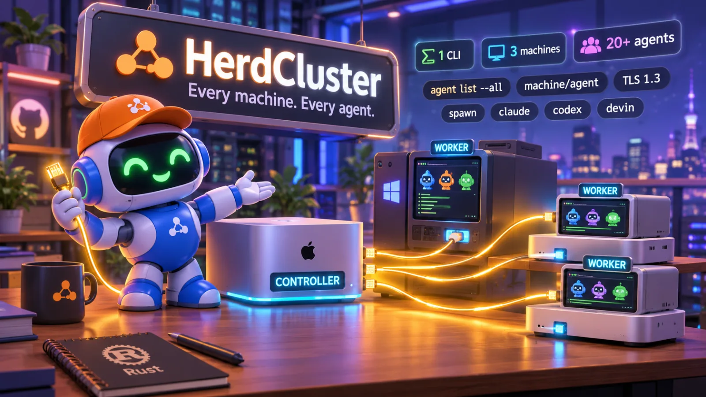

# HerdCluster — One CLI. Every machine. Every coding agent.

<div align="center">
  
</div>

<div align="center">


</div>

**Turn every machine you own into one agent fleet.** HerdCluster lets a single
Mac controller spawn, prompt, watch, and manage coding agents — Claude Code,
Codex, Devin, OpenCode, and 20+ more — on remote Windows, WSL2, Linux, and
Mac workers, all through one terminal.

<div align="center">

```bash
curl -fsSL "https://raw.githubusercontent.com/quangdang46/herdr_cluster/main/install.sh" | bash
```

</div>

---

## Why spawn *separate* coding agents?

Harness-native subagents make multi-agent work **worse** — an authority
gradient forms between orchestrator and subagent, and production runs show
the same four failure modes every time:

- **Subagents become livestock** — they read and edit to order, contributing
  nothing a function call couldn't.
- **Reflexive agreement** — they over-agree, or swing to blanket resistance;
  neither produces correct work.
- **Context burned on polling** — the orchestrator wastes its window asking
  "are you done yet" instead of reasoning.
- **Identity deception backfires** — a worker that *knows* it is subordinate
  stops acting like an owner of the outcome.

Documented incident: four workers delegated through a built-in subagent tool
went fleet-invisible, two died mid-flight on restart, and supervision stayed
down 73 minutes unnoticed. The fix was never "fewer agents" — it was **real,
independent agents** coordinated from outside.

That is the SLP (Supervisor → Lead → Peer) architecture: every worker is a
full agent with its own session, worktree, and lifecycle — spawned plainly,
free to challenge a premise, and never told it is a subagent. HerdCluster is
that pattern at cluster scale: one CLI spawns, prompts, watches, and retasks
peers across every machine you own.

- [anti_subagent](https://github.com/quangdang46/anti_subagent) — the thesis
  and the production evidence (archived; wrapper approach superseded).
- [pi-anti-subagent](https://github.com/quangdang46/pi-anti-subagent) — the
  successor: SLP enforced *inside* the Pi runtime.
- [SLP: Supervisor–Lead–Peer](https://ultrabuilders.xyz/en/posts/slp-supervisor-lead-peer) —
  the orchestration pattern itself.

---

## Agent Quickstart

HerdCluster is built to be driven by agents, not just humans. Every read
command supports `--json`; mutating commands return structured envelopes.

```bash
herdcluster machines --json                 # stdout: machine array
herdcluster agent list --all --json         # stdout: agent rows, every machine
herdcluster spawn builder --kind claude \
  --machine auto --repo ~/Projects/api --json
herdcluster agent wait builder --until done --timeout 30m
```

**Contract:** stdout carries data (JSON with `--json`, tables otherwise),
stderr carries diagnostics, exit `0` = success. Error envelopes use stable
codes (`worker_unreachable`, `agent_pane_busy`, `invalid_pairing_code`, …)
so scripts and agents can branch on them. An `AGENTS.md` blurb ships in the
repo; `herdcluster skills install` drops an orchestration skill into your
project so coding agents learn the command surface automatically.

---

## TL;DR

### The Problem

You have a Mac Studio, a Windows desktop, two Mac minis, and a WSL2 box.
Each one can run coding agents — but they are islands. You SSH into each,
start agents by hand, lose track of which pane is doing what, and re-type
the same prompt on three machines. Existing orchestrators assume a datacenter
or a single OS; none of them speak the language of *your* machines.

### The Solution

HerdCluster pairs your machines into an encrypted cluster in one command —
no SSH keys, no IPs, no port forwarding. A worker dials *out* to the
controller, so it works behind NAT. From then on, every machine's agents
appear under one global ID (`machine/agent`) and one CLI:

```bash
herdcluster spawn auth-fix --kind claude --machine auto --repo ~/Projects/api
herdcluster agent prompt DESKTOP-WIN/auth-fix "add rate limiting"
herdcluster agent read DESKTOP-WIN/auth-fix
```

It does not fork or patch [herdr](https://github.com/herdrdev/herdr) — it
drives each machine's **unmodified** herdr instance through herdr's own
published NDJSON socket API. Upstream herdr updates flow through untouched.

### Why HerdCluster?

| Capability | HerdCluster | herdr alone | SSH + tmux scripts | Cloud agent platforms |
|---|:---:|:---:|:---:|:---:|
| Multi-machine fleet in one CLI | ✅ | ❌ | ⚠️ hand-rolled | ⚠️ rented infra only |
| Zero-config pairing (no keys/IPs) | ✅ one-time code | n/a | ❌ manual | ❌ accounts + billing |
| Uses your existing agent CLIs logins | ✅ | ✅ | ✅ | ❌ vendor lock-in |
| Works on macOS + Windows/WSL2 + Linux | ✅ | ✅ single machine | ⚠️ per-OS glue | ❌ |
| Encrypted mutual-TLS transport | ✅ Ed25519 + TLS 1.3 | ❌ local socket | ❌ depends on SSH | ✅ |
| Resource-aware `--machine auto` | ✅ CPU/RAM/slots | ❌ | ❌ | ⚠️ opaque |
| No modification to agent runtimes | ✅ pure API wrapper | ✅ | ✅ | n/a |
| Cost | free, your hardware | free | free | per-seat pricing |

---

## Quick Example

```bash
# ── One-time setup ──────────────────────────────────────────────
# On the Mac Studio (controller):
herdcluster init                 # prints an 8-char pairing code

# On each worker (Windows/WSL2, Mac mini, Linux box):
curl -fsSL "https://raw.githubusercontent.com/quangdang46/herdr_cluster/main/install.sh" | bash
herdcluster join --controller <MAC_LAN_IP>:47820   # enter the code once
herdcluster autostart install                     # survive reboots

# ── Daily driving ───────────────────────────────────────────────
herdcluster machines                             # fleet health + live CPU/RAM
herdcluster spawn coder1 --kind claude \
  --machine auto --repo ~/Projects/api           # auto = best machine by load
herdcluster agent prompt local/coder1 "implement auth module"
herdcluster agent read local/coder1              # tail the agent's terminal
herdcluster agent wait local/coder1 --until done --timeout 30m
herdcluster agent list --all                     # every agent, every machine
```

---

## Install

**curl (recommended, macOS + Linux x86_64/arm64):**

```bash
curl -fsSL "https://raw.githubusercontent.com/quangdang46/herdr_cluster/main/install.sh" | bash
```

The script detects OS/arch, downloads the release asset, verifies its
SHA-256 against `checksums.txt`, and installs to `~/.local/bin`.

**Windows:** run inside WSL2 (Ubuntu) — same curl one-liner. Native Windows
support is on the roadmap.

**From source:**

```bash
git clone https://github.com/quangdang46/herdr_cluster && cd HerdCluster
cargo install --path crates/herdcluster --locked
```

Requires Rust stable. Pre-built binaries ship for `aarch64-apple-darwin`,
`x86_64-apple-darwin`, and `x86_64-unknown-linux-gnu`.

---

## Commands

| Command | What it does |
|---|---|
| `herdcluster init` | Become the cluster controller; prints pairing code |
| `herdcluster join --controller <host:port>` | Pair once as a worker, then run the worker daemon |
| `herdcluster worker` | Run the worker daemon (after join) |
| `herdcluster machines` | Fleet table: status, agents, live CPU/RAM |
| `herdcluster spawn <name> --kind <k> --machine <m>` | Spawn an agent (`--machine auto` picks by load) |
| `herdcluster agent list/get/read/wait/prompt/send-keys/rename` | Drive any agent by global ID `machine/agent` |
| `herdcluster status [--all]` | Cluster overview / merged agent table |
| `herdcluster doctor [--fix] [--machine <m>]` | Layered health checks with plain-language fixes |
| `herdcluster config get/set/unset` | Cluster config (`cluster.json`) |
| `herdcluster skills install` | Install bundled orchestration skills into a project |
| `herdcluster revoke <worker>` | Revoke a worker pairing + delete its credential |
| `herdcluster autostart install/uninstall` | systemd/launchd persistence for the worker daemon |

Global flags: `--json` on read commands, `-v/--verbose` diagnostics on
stderr, `--machine <label>` to scope machine-aware commands.

### Agent kinds

Whatever herdr detects on the worker: `claude`, `codex`, `devin`,
`opencode`, `gemini`, and 20+ more — `herdcluster doctor` lists which agent
CLIs are on PATH per machine. The agent CLI's own login is required once
per machine; HerdCluster never touches credentials.

---

## Architecture

```
herdcluster (Mac controller)
   │  NDJSON over unix socket          │  TLS 1.3 stream mux
   ▼                                   ▼
local herdr API socket          worker daemon (Windows/WSL2/Mac/Linux)
   │                                   │  installs + supervises
   ▼                                   ▼
herdr 0.9.5 (unmodified)         herdr release binary (auto-installed)
   │                                   │
   ▼                                   ▼
coding agents on THIS machine    coding agents on THAT machine
```

- **Transport:** Ed25519 mutual TLS 1.3, worker dials out only (NAT-friendly),
  stream mux with heartbeat + auto-reconnect.
- **Pairing:** one-time 8-char Crockford code (5-min TTL) → long-lived worker
  credential. Pair once, never again unless revoked.
- **API boundary:** herdcluster speaks herdr's published NDJSON socket
  protocol (`{id, method, params}` per connection). A compat guard pins the
  verified protocol version and fails loudly on upstream drift.
- **State:** global `~/.config/herdcluster/` (identity, registry, credentials
  — never committed) + optional project-level `.herdcluster/` for
  per-repo agent tracking.

Rust workspace: `herdcluster` (bin) + `api-client`, `cluster-core`,
`cluster-net`, `cluster-bridge`, `cluster-fleet`, `cluster-node`.

---

## Troubleshooting

| Symptom | Cause | Fix |
|---|---|---|
| `invalid_pairing_code` on join | Code expired (5-min TTL) or already used | Re-run `herdcluster init` for a fresh code |
| Worker flaps online/offline | Old herdcluster version (< session fix) | `herdcluster --version`; upgrade via install.sh |
| `agent_pane_busy` on spawn | Agent CLI still starting in fresh pane | Retry — spawn now splits a fresh pane automatically |
| `worker_unreachable` on spawn | Worker daemon down or network change | `herdcluster machines`; restart `herdcluster worker` on that machine |
| Discovery finds nothing | mDNS blocked by NAT/VPN | `join --controller <ip>:47820` explicitly |
| Agent kind shows `-` | herdcluster < kind-parsing fix | Upgrade; kind reads herdr's `agent` field |
| WSL2 agent asks permission per command | Agent CLI not in bypass mode | Send keys once: `down down down enter` selects Bypass |

Run `herdcluster doctor` for a full layered diagnosis; `doctor --fix` attempts
safe remediations (state dirs, permissions, daemon restart).

---

## Limitations

- **Agent CLIs are per-machine.** Each worker needs its own `claude login` /
  `codex login` — HerdCluster orchestrates, it does not share credentials.
- **WSL2 networking.** mDNS discovery usually can't cross the WSL2/Windows
  boundary — pass `--controller <windows-host-ip>:47820` explicitly.
- **No native Windows yet.** Windows workers run inside WSL2.
- **herdr API compat.** Built against herdr's NDJSON socket API (verified on
  0.9.5, protocol 22). A breaking upstream API change requires a herdcluster
  update — the compat guard detects this early via `doctor`.
- **Single controller.** One controller per cluster today; multi-controller
  failover is future work.

---

## FAQ

**Does this modify herdr or the agent CLIs?**
No. HerdCluster is a pure wrapper — it speaks herdr's published socket API
and never patches agent runtimes. Upgrade herdr freely.

**Do I need to pair again after reboot?**
No. Pairing happens once; the worker stores a long-lived credential and
reconnects automatically. `herdcluster autostart install` keeps the daemon
alive across reboots.

**What if two machines have the same agent name?**
Global IDs are `machine/agent`, so `DESKTOP-WIN/coder1` and
`MAC-MINI/coder1` never collide.

**Can agents on different machines talk to each other?**
Indirectly — your orchestrator (human or coding agent) relays via
`agent prompt`/`agent read`. Direct agent-to-agent networking is not part of
the transport.

**Is traffic encrypted?**
Yes — Ed25519 mutual TLS 1.3 between controller and workers; workers only
dial out, so no inbound ports need opening on workers.

**Which machines are supported?**
Controller: macOS (arm64/x86_64) or Linux. Workers: macOS, Linux, and
Windows via WSL2. Resources permitting, any machine that runs herdr works.

---

## Development

```bash
cargo build --workspace          # build all crates
cargo test --workspace           # 200+ unit/integration tests
cargo clippy --workspace         # lint
```

Architecture and work breakdown: [docs/herdcluster/PLAN.md](docs/herdcluster/PLAN.md).
Handoff/runbook for setting up a second machine:
[docs/herdcluster/HANDOFF.md](docs/herdcluster/HANDOFF.md).
Work items tracked as beads in [`.beads/`](.beads/).

---

## License

MIT
